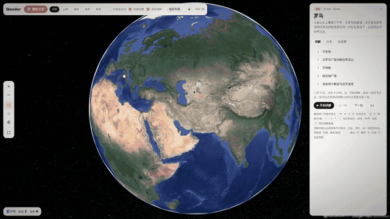

<div align="center">

# 🌍 Wander

### Fly anywhere on Earth in photorealistic 3D, with an AI tour guide narrating the way.

**188 destinations · 64 countries · 886 narrated stops · 30 hiking trails · real-time city day trips**

It runs in your browser, with no install, no build step and no backend.

[**▶ Watch the 90-second trailer**](docs/wander-trailer.mp4) · [Quick start](#-quick-start) · [中文说明](README.zh-CN.md)

<a href="docs/wander-trailer.mp4"></a>

</div>

---

Google Earth shows you the planet. **Wander takes you on a trip through it.**

Pick a city and the camera dives in from orbit. A narrator then tells you where you are: what the city sits on, how its streets are laid out, and how people live there. From there it walks you stop by stop through the places worth seeing.

Each sentence of narration gets its own camera move, timed to the voice, the way a documentary crew would cut it. When you want to look around yourself, grab the keyboard and fly.

## ✨ What makes it different

|  |  |
|---|---|
| 🏙️ **Real photorealistic 3D** | Built on [Google Photorealistic 3D Tiles](https://developers.google.com/maps/documentation/tile/3d-tiles) with CesiumJS. These are the same textured meshes behind Google Earth: every building, bridge and tree. |
| 🎙️ **A guide, not a map** | 1,300+ narration clips, voiced with Qwen TTS. Each destination opens with a big-picture briefing (geography, city structure, local life), then tours its stops automatically. |
| 🎬 **Camera director** | The camera doesn't spin aimlessly. Each subtitle line gets a move matched to its length: push-in, reveal, low glide, arc or sweep. |
| ☕ **Day trips on a real clock** | *09:10, coffee at a Paris café, then a 25-minute walk to the Eiffel Tower.* The camera follows real walking, bus and metro routes at street level while a clock runs. Paris, Kyoto, Lisbon and Tokyo are available today. |
| 🥾 **30 famous hikes in 3D** | Tre Cime, Tour du Mont Blanc, the Inca Trail, Torres del Paine W, Everest Base Camp and more. The camera follows the terrain and never clips into a mountain. |
| 🎮 **Game-style controls** | WASD to fly, Q/E for altitude, Shift to boost. Speed scales with your height above the ground. |
| 🧭 **Honest about coverage** | Every destination is scanned for real 3D geometry. Places where Google only has flat satellite imagery (for example Cairo) are labelled, so you know what you'll get. |
| 🎲 **Guess-the-city mode** | Get dropped somewhere random, look around and guess the country. |
| 🛂 **Passport** | Collect stamps for the places you've visited. |

## 🚀 Quick start

```bash
git clone https://github.com/avacx/wander.git
cd wander
python3 serve.py          # or double-click start.command (macOS) / start.bat (Windows)
```

1. Get a **Google Maps Platform API key** with the *Map Tiles API* enabled ([guide](https://developers.google.com/maps/documentation/tile/get-api-key)). The free monthly quota is plenty for personal use.
2. Paste the key into ⚙️ Settings. It is stored only in your browser's `localStorage` and is never sent anywhere except Google.
3. Pick a destination and enjoy the trip.

> Wander uses no framework and no npm install. CesiumJS is vendored in `cesium/`, so it also works on networks where public CDNs are blocked.

## 🎮 Controls

| Key | At a stop / on a route | Free roam |
|---|---|---|
| `W` `S` | zoom in / out | fly forward / back |
| `A` `D` / `←` `→` | orbit | strafe / turn |
| `↑` `↓` | tilt | look up / down |
| `Q` `E` | switch to free roam | descend / climb |
| `Shift` | | boost ×3 |
| `C` | | back to the guided view |
| `,` `.` | previous / next stop | |
| Trackpad pinch / wheel | zoom toward the cursor | |

## 🧱 How it works

```
earth-explorer.html   one self-contained page: UI + engine (built from src/)
├─ CesiumJS           streams Google Photorealistic 3D Tiles
├─ regions.js         188 destinations: stops, camera shots, narration, trails, 3D-coverage flags
├─ journeys.js        day-trip itineraries with routed walking / bus / metro paths
├─ audio/             pre-generated narration (mp3)
└─ dem/               coarse terrain grids so trail cameras never go underground
```

- **Camera director**: narration is split into sentences. Each sentence gets a camera move whose length matches the speech, eased with smootherstep, and the same move is never used twice in a row.
- **Terrain-safe flight**: free-roam speed is proportional to height above ground. The camera keeps at least 12 m of clearance using live `sampleHeight` checks plus the bundled DEM grids.
- **3D-coverage scan**: a 9×9 height grid is sampled around every stop. Flat terrain where buildings should be means Google has no meshes there, and the stop is flagged.
- **Fast arrivals**: on arrival in a new region, the tiles for each viewpoint are pre-loaded before the tour begins.

## 🗺️ Roadmap

- [ ] English UI and narration (the UI is currently Chinese; PRs welcome!)
- [ ] Day trips for more cities
- [ ] User-authored tours (a JSON in, a guided trip out)
- [ ] Bring-your-own TTS / LLM guide that answers questions about what you're looking at
- [ ] VR / WebXR mode

## 🤝 Contributing

Adding a destination is mostly writing data: see `src/regions.js` for the format (then `node src/build.js src` to rebuild `earth-explorer.html`) of stops, shots and trails. Issues and PRs for new places, translations and camera moves are all very welcome.

## 📄 License & attribution

- Code: [MIT](LICENSE)
- 3D imagery: © Google. Use is subject to the [Google Maps Platform Terms](https://cloud.google.com/maps-platform/terms). You need your own API key, and on-screen attributions must stay visible.
- Rendering: [CesiumJS](https://cesium.com/platform/cesiumjs/) (Apache-2.0)
- Narration voice: generated with Alibaba Cloud Qwen TTS
- Routing for day trips: [OSRM](https://project-osrm.org/) on OpenStreetMap data (© OpenStreetMap contributors)

<div align="center">
<sub>If Wander took you somewhere you've never been, a ⭐ helps other travellers find it.</sub>
</div>
