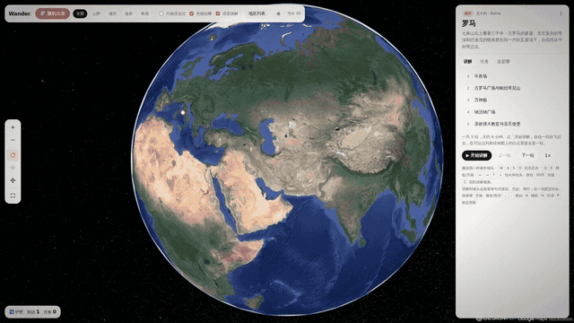

<div align="center">

# 🌍 Wander

### 在写实 3D 地球上去任何地方旅行，路上有 AI 导游给你讲解

**188 个目的地 · 64 个国家 · 886 个讲解站 · 30 条徒步路线 · 按真实时间走的城市一日游**

打开浏览器就能玩，不用安装，不用构建，也不用后端。

[**▶ 看 90 秒预告片**](docs/wander-trailer.mp4) · [快速开始](#-快速开始) · [English](README.md)

<a href="docs/wander-trailer.mp4"></a>

</div>

---

Google Earth 让你看到地球，**Wander 带你去旅行。**

选一座城市，镜头从太空一路俯冲下去。导游先讲个大概：这座城在什么地方、城市格局怎么样、当地人怎么生活。然后带你一站一站地看。

讲解的每一句话都配一个运镜，节奏跟着语音走，像纪录片那样剪。想自己看的时候，按 WASD 就能飞。

## ✨ 亮点

- 🏙️ **真正的写实 3D**：基于 Google Photorealistic 3D Tiles 和 CesiumJS，用的是和 Google Earth 同一套带纹理的 3D 模型，楼、桥、树都在。
- 🎙️ **是导游，不只是地图**：1300 多段 Qwen TTS 配音。每个地方先讲整体（地理、城市结构、市民生活），讲完自动开始逐站游览。
- 🎬 **镜头导演**：每句字幕配一个运镜，时长跟这句话一样。有推近、升起看全貌、低空滑过、弧线绕行、横扫几种，不再傻转圈。
- ☕ **按真实时间的一日游**：比如「09:10 在巴黎咖啡馆，步行 25 分钟去埃菲尔铁塔」。镜头沿真实的步行、公交、地铁路线在街道高度跟拍，时钟同时在走。现在有巴黎、京都、里斯本、东京四座城市。
- 🥾 **30 条经典徒步路线**：多洛米蒂三峰、环勃朗峰、印加古道、百内 W 线、珠峰大本营等。镜头贴着地形走，不会钻进山里。
- 🎮 **游戏式操作**：WASD 飞行，Q/E 升降，按住 Shift 加速，速度会随离地高度自动调整。
- 🧭 **标明 3D 覆盖**：每个地点都扫描过有没有真实 3D 模型。像开罗这样只有平面卫星图的地方会标出来。
- 🎲 **猜城市**和 🛂 **旅行护照**。

## 🚀 快速开始

```bash
git clone https://github.com/avacx/wander.git
cd wander
python3 serve.py      # 或双击 start.command（macOS）/ start.bat（Windows）
```

1. 准备一个开通了 *Map Tiles API* 的 Google Maps Platform API Key。每月免费额度个人用足够了。
2. 在 ⚙️ 设置里填进去。Key 只存在你自己浏览器的 localStorage 里。
3. 选个目的地出发。

用 `start.command` 或 `start.bat` 启动时，会先自动 `git pull` 拉最新版。

## 🎮 操作

| 按键 | 讲解站 / 路线上 | 自由漫游 |
|---|---|---|
| `W` `S` | 推近 / 拉远 | 前进 / 后退 |
| `A` `D` / `←` `→` | 绕目标转 | 平移 / 转向 |
| `↑` `↓` | 调整俯仰 | 抬头 / 低头 |
| `Q` `E` | 切到自由漫游 | 下降 / 上升 |
| `Shift` | | 加速 ×3 |
| `C` | | 回到讲解视角 |
| `,` `.` | 上一站 / 下一站 | |

## 📄 许可与署名

- 代码：MIT
- 3D 影像 © Google，使用需遵守 Google Maps Platform 条款，需要自备 API Key，画面上的署名要保留
- 渲染：CesiumJS（Apache-2.0）；配音：阿里云 Qwen TTS；一日游路线：OSRM / OpenStreetMap
